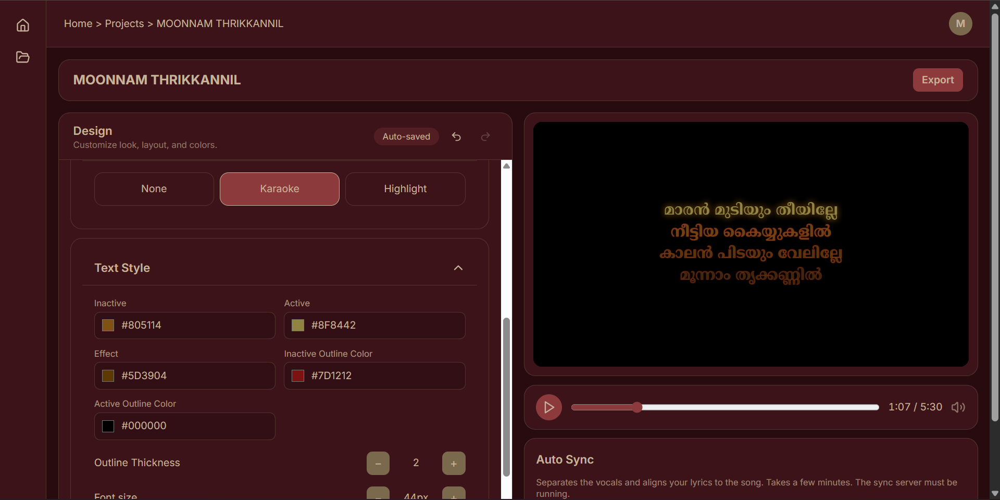
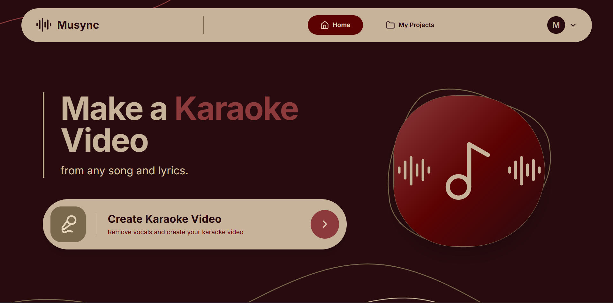
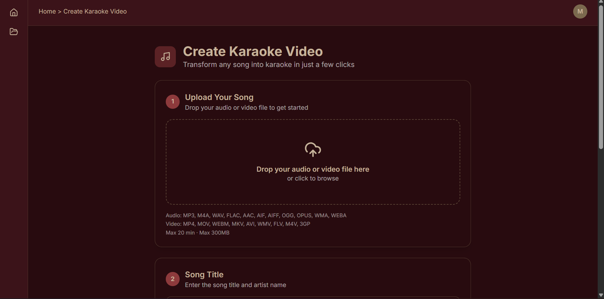
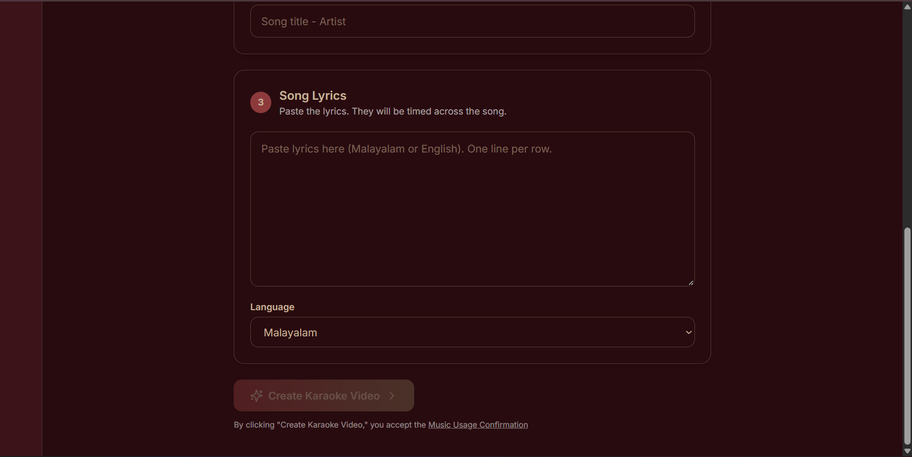

# RIA Karaoke Maker

**Create beautiful karaoke videos with synchronized lyrics and customizable visual effects.**

## Project Overview

RIA Karaoke Maker is a karaoke video creation application designed to help users turn songs into engaging karaoke videos. It provides lyric synchronization, text customization, and video preview features through a user-friendly interface.

## Key Features

- **Lyric Synchronization:** Adjust lyric timings to match the song.
- **Malayalam Lyrics Support:** Display Malayalam lyrics in karaoke videos.
- **Customizable Text Effects:** Choose between None, Karaoke, and Highlight effects.
- **Text Customization:** Customize lyric colors, outlines, fonts, and styles.
- **Live Video Preview:** Preview the karaoke output while editing.
- **Video Export:** Export the created karaoke video.

## Technologies Used

- Next.js
- React
- TypeScript
- Tailwind CSS
- Python
- FastAPI
- Electron

## Application Screenshots

### 1. Home Page

### 2. Karaoke Editor

### 3. Lyric Customization

### 4. Video Preview

## Future Enhancements

- Improved automatic lyric synchronization.
- Support for additional languages.
- More karaoke templates and visual effects.
- Enhanced video export quality.
- Additional customization options.

## Project Purpose

This project demonstrates the development of a karaoke video creation application with a focus on lyric synchronization, customization, and user-friendly design.

---

**Developed by:** Rizwana Muhammed

**Project Name:** RIA Karaoke Maker
